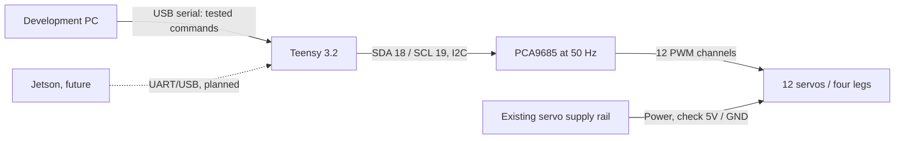

# Physical hardware connections and calibration

**Physical controller:** Teensy 3.2; Arduino framework via PlatformIO. **PWM driver:** PCA9685, I²C address typically 0x40 in previous test code, 50 Hz servo pulses. **Actuators:** 12 hobby servos, labeled DS3225MG in the previous discussion (model marking not cross-checked against a datasheet).

## Signal overview

At the time of testing, the existing servo rail measured approximately **5 V**. Do not add an external supply in parallel without first identifying the existing distribution, common grounds, supply and regulator ratings. Do not power 12 servos from USB.

## PCA9685 channel allocation

| Leg | Hip roll | Hip pitch | Knee |
| --- | ---: | ---: | ---: |
| Front left | CH0 | CH1 | CH2 |
| Rear left | CH4 | CH5 | CH6 |
| Front right | CH8 | CH9 | CH10 |
| Rear right | CH12 | CH13 | CH14 |

Unused channels: CH3, CH7, CH11, CH15. Detailed measured limits and standing references are in [`hardware/servo_calibration.csv`](../hardware/servo_calibration.csv).

**Important:** PWM increase/decrease does not necessarily correspond to the same joint-angle direction on every leg; the sign-to-angle calibration is **not** fully defined here. In particular, CH12 PWM increase was recorded as **inward**, while 1400 µs was the standing reference.
